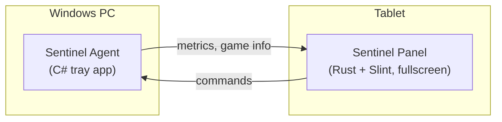

# Sentinel

**A dedicated touchscreen command panel for a Windows gaming PC.**

Sentinel sits beside your PC and shows live hardware metrics — temperatures, utilization, clocks, uptime — with one-touch buttons for things like launching Steam or jumping back into your last game. It keeps that information off your main monitor, always visible at a glance.

> **Status:** 🚧 In progress — M0, M2, and M3 substantially complete (hardware-blocked items excluded). M4 complete. M5 in progress — #62 and #96 done. M1 in progress — hardware chosen (Samsung Galaxy Tab A11, Android).

## Index

**Documentation**

- [Architecture](documentation/ARCHITECTURE.md): components, connection model, protocol, security, deployment
- [Tech Stack](documentation/TECH_STACK.md): each technology choice with pros, cons, and alternatives
- [Roadmap](documentation/SPRINTS.md): milestones from dev setup to v1.0 and beyond
- [Dev Norms](documentation/DEV_NORMS.md): branch workflow, board automation, commit and PR conventions
- [Dev Setup](documentation/DEV_SETUP.md): required tools and step-by-step setup for a new machine

**On this page**

- [How it works](#how-it-works)
- [Features](#features)
- [Tech stack](#tech-stack)
- [Repository layout](#repository-layout)
- [Getting started](#getting-started)
- [Contributing workflow](#contributing-workflow)
- [License](#license)

---

## How it works

Sentinel has two halves connected by a single USB-C cable that carries both power and data:



- **Sentinel Agent** runs on the PC. It reads hardware sensors, inspects the Steam library, and runs a fixed whitelist of actions.
- **Sentinel Panel** runs on the tablet. It boots straight into a fullscreen dashboard and sends button presses back to the agent.
- They talk over TCP using a shared Protobuf schema, through USB networking on the cable.

See [Architecture](documentation/ARCHITECTURE.md) for the full design.

## Features

### MVP

- 📊 Live hardware dashboard: CPU and GPU utilization, temperatures, clocks, power, VRAM, RAM, disk, uptime
- 🧾 Basic system specs (CPU, GPU, RAM, OS)
- 🎮 Launch Steam
- ▶️ Launch your last-played game, with cover art

### Planned

- 🧩 Configurable launcher buttons (browser, Task Manager, Discord, …)
- 🔊 Volume and media controls with "now playing"
- 🌐 Network dashboard: IPs, speeds, latency, and devices on your LAN

See the [Roadmap](documentation/SPRINTS.md) for the full milestone plan.

## Tech stack

| Area | Choice |
|---|---|
| PC agent | C# / .NET, LibreHardwareMonitorLib |
| Tablet app | Rust, Slint UI (Android backend) |
| Tablet OS | Android (Samsung Galaxy Tab A11) |
| Link | USB-C power + USB networking, TCP |
| Protocol | Length-prefixed Protobuf |
| CI | GitHub Actions |

See [Tech Stack](documentation/TECH_STACK.md) for the reasoning, trade-offs, and alternatives behind each choice.

## Repository layout

```
sentinel/
├── proto/          # sentinel.proto — shared protocol schema
├── agent/          # Sentinel.Agent — C# solution (src/ + tests/)
├── panel/          # sentinel-panel — Rust crate + .slint UI files
├── tools/          # fake-agent for UI development without hardware
├── deploy/         # Task Scheduler config, ADB deploy notes, device notes
└── documentation/  # design documents
```

## Getting started

See [Dev Setup](documentation/DEV_SETUP.md) for step-by-step instructions to install the required tools, build both halves, run tests, and launch the panel UI on your desktop.

## Contributing workflow

Work is tracked as GitHub issues using three templates:

- **Feature:** a small slice of value you can see or touch on the device
- **Bug:** something broken, fixed test-first
- **Chore:** setup, CI, tooling, refactors, docs, or research

Every change goes through a pull request — squash merged with `Closes #N` in the description. See [Dev Norms](documentation/DEV_NORMS.md) for the full workflow.

## License

This project is licensed under the [GNU General Public License v3.0](LICENSE). See the LICENSE file for the full text.

Sentinel Panel links [Slint](https://slint.dev), which is also licensed under GPL v3 for open-source use.
