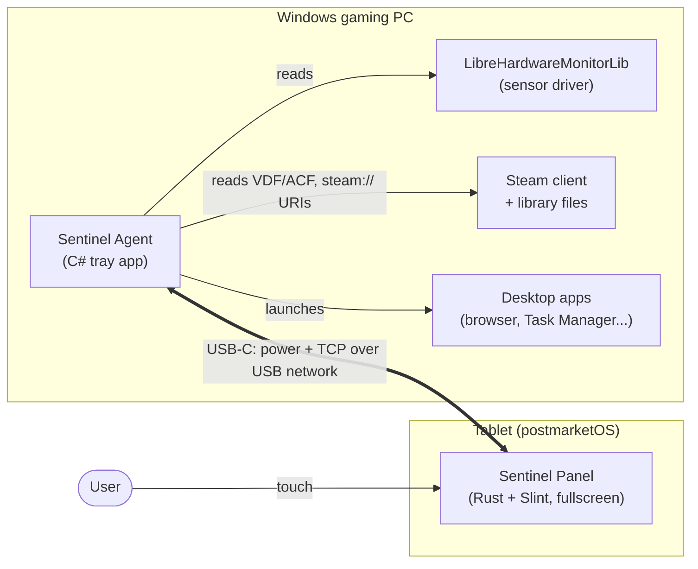
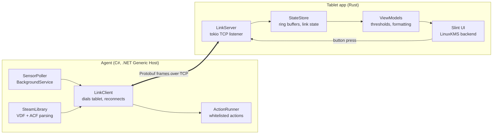
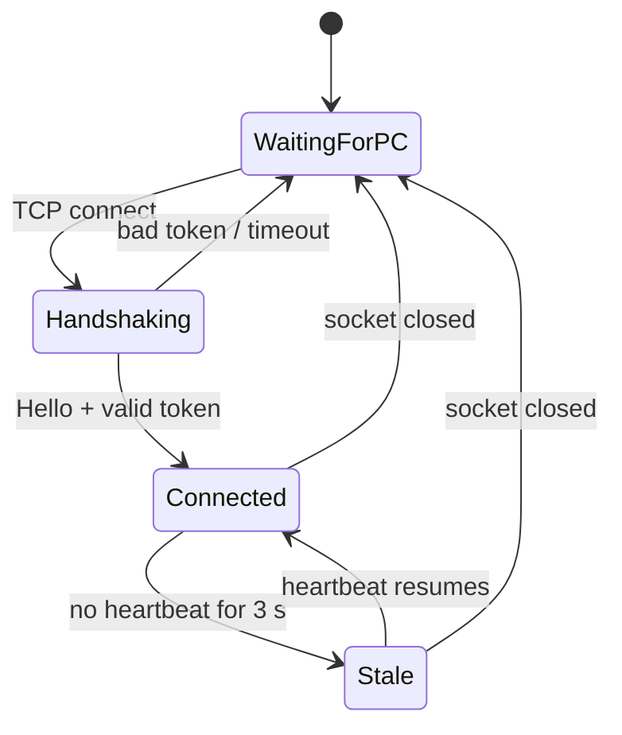
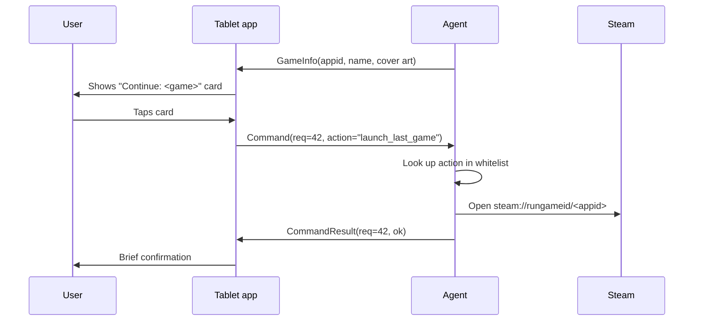
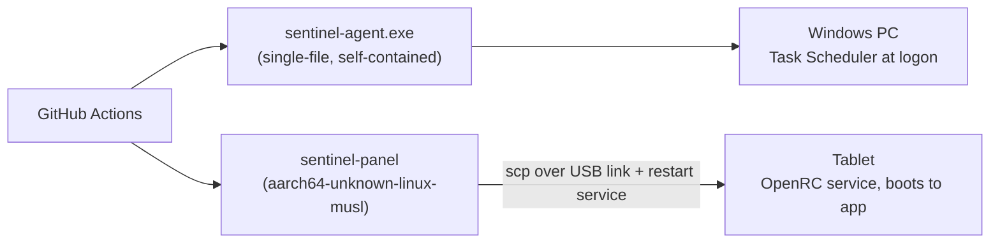

# Architecture — Sentinel

> Status: **Proposed**. This document describes the target design. Update it as decisions change.

## 1. Overview

Sentinel is a dedicated tablet that sits next to a Windows gaming PC and acts as a second, always-on control surface. It shows live hardware metrics and offers one-touch actions (launch Steam, launch last-played game, and more later), without using any space on the main monitor.

The system has two halves connected by a single USB-C cable that carries both **power** and **data**:

| Half | Runs on | Language | Role |
|---|---|---|---|
| **Sentinel Agent** | Windows PC | C# (.NET) | Reads sensors, inspects the Steam library, executes whitelisted actions |
| **Sentinel Panel** | ARM tablet running postmarketOS | Rust + Slint | Renders the dashboard, sends commands |

### Naming conventions

| Thing | Name |
|---|---|
| Repository | `sentinel` |
| PC agent (C# solution / namespace) | `Sentinel.Agent` |
| PC agent executable | `sentinel-agent.exe` |
| Tablet app (Rust crate / binary) | `sentinel-panel` |
| Protocol schema / Protobuf package | `proto/sentinel.proto` / `sentinel.v1` |
| UI-dev stand-in for the agent | `tools/fake-agent` |

## 2. System context

## 3. Components

### Agent (Windows)

| Component | Responsibility |
|---|---|
| `SensorPoller` | Polls LibreHardwareMonitorLib roughly once per second and produces `MetricsSnapshot`; gathers static `Specs` once |
| `SteamLibrary` | Finds Steam install and library folders, parses `localconfig.vdf` (last played) and `appmanifest_*.acf` (names), loads cached cover art |
| `ActionRunner` | Maps an **action ID** to a predefined command. Never executes arbitrary input |
| `LinkClient` | Connects to the tablet, performs the handshake, streams data, retries with backoff |
| Tray icon | Status (connected / disconnected), quit, open logs |

Runs as a **user-session tray app** started at logon by Task Scheduler with highest privileges (admin is needed for CPU temperature sensors). It must not be a Windows Service: services run in session 0 and cannot open windows on the user's desktop.

### Tablet app (Linux)

| Component | Responsibility |
|---|---|
| `LinkServer` | Listens on the USB network interface, authenticates the agent, decodes frames |
| `StateStore` | Current values, ~60 s ring-buffer history per metric, connection state |
| `ViewModels` | Pure logic: unit formatting, threshold colors (normal / warm / hot), staleness |
| Slint UI | Renders directly to the display via KMS/DRM — no X11/Wayland compositor |

Threading: the Slint event loop owns the main thread; a tokio runtime handles networking; updates cross to the UI via `slint::invoke_from_event_loop`.

## 4. Link and connection model

- The tablet runs in **USB gadget mode** (CDC-NCM), so Windows sees it as a network adapter.
- postmarketOS typically gives the tablet a fixed address on the USB link (e.g. `172.16.42.1`) and serves DHCP to the PC.
- **The tablet listens; the agent dials out.** The PC never opens a listening port, and the agent always knows where the tablet is.
- The same cable supplies power from the PC's USB-C port (typically 5 V at 1.5–3 A).

### Connection state machine (tablet side)

The UI shows each state explicitly: a "waiting for PC" screen, a dimmed or flagged dashboard when data is stale, and the live dashboard when connected.

## 5. Protocol

- **Schema:** one shared `proto/sentinel.proto` (package `sentinel.v1`), with code generated for C# (Google.Protobuf) and Rust (`prost`).
- **Framing:** length-prefixed Protobuf messages over TCP.
- **Envelope:** every frame carries a protocol version and exactly one message (`oneof`).

| Message | Direction | When |
|---|---|---|
| `Hello` | Agent → Tablet | On connect: protocol version, auth token |
| `Capabilities` | Agent → Tablet | After handshake: features and action list the agent supports |
| `Specs` | Agent → Tablet | Once per connection: CPU/GPU model, RAM, OS |
| `MetricsSnapshot` | Agent → Tablet | ~1 Hz: utilization, temps, clocks, power, memory, uptime |
| `GameInfo` | Agent → Tablet | On connect and when it changes: app ID, name, cover art bytes |
| `Command` | Tablet → Agent | Button press: request ID + action ID |
| `CommandResult` | Agent → Tablet | Success or error for a request ID |
| `Heartbeat` | Both | Every second; drives stale detection |

**Compatibility rule:** never reuse or renumber Protobuf fields. New features add new messages and are announced via `Capabilities`, so older tablet builds keep working.

### Example: launching the last-played game

## 6. Security model

| Threat / risk | Mitigation |
|---|---|
| Something else on the link sends commands | Pre-shared token in `Hello`; connection dropped on mismatch |
| Command injection | Tablet sends **action IDs only**; commands are defined in agent config on the PC |
| Exposing the PC to the network | PC opens no listening port; it only dials out over the USB link |
| Agent runs elevated | Keep the elevated surface small; validate all inbound messages; no shell execution of message content |
| Stolen or tampered tablet | Low impact by design: it can only trigger whitelisted actions |

Optional learning extension: TLS (or Noise) over the link with pinned keys.

## 7. Deployment

- postmarketOS is Alpine-based (musl libc), so tablet builds target `aarch64-unknown-linux-musl`.
- postmarketOS uses OpenRC by default; the app runs as an OpenRC service that starts at boot.

## 8. Failure modes

| Situation | Expected behavior |
|---|---|
| Tablet boots before the PC or agent | "Waiting for PC" screen; agent connects when ready |
| Agent crashes or PC sleeps | Heartbeat stops → stale indicator → waiting screen |
| PC shuts down | Depends on BIOS USB power-in-off (ErP) setting: tablet powers off, or stays on and idles/dims |
| Steam not installed / not logged in | `GameInfo` absent; launcher card hidden or disabled |
| Sensor missing (e.g. no GPU hotspot) | Field omitted; UI hides that tile rather than showing zero |

## 9. Open questions

- Does the chosen tablet expose a battery charge limit in Linux? (Always-plugged battery health.)
- Does the PC's USB-C port supply enough power at the brightness we want?
- Should the tablet stay powered when the PC is off?
