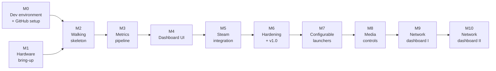

# Roadmap — Sentinel

> Status: **In progress** — M0, M2, and M3 substantially complete (hardware-blocked items excluded). M4 functionally complete — #56–60 done, #61 hardware blocked. This is a fun personal project, so there are no deadlines or time boxes. Milestones are done when they're done; the order matters more than the pace.

## Goals of the project

1. **A useful device:** a polished, always-on dashboard and control surface that frees up main-monitor space.
2. **Learning:** networking (sockets, framing, USB networking, LAN discovery), embedded Linux, Rust, Windows internals, CI/CD.
3. **Engineering discipline:** TDD on both halves, a versioned protocol, documented decisions.

## Milestone map

M0 and M1 are independent and can happen in either order or side by side. Everything after them builds on both.

---

## MVP (Milestones 0–6)

### Milestone 0 — Dev environment and GitHub setup ✓ Complete

**Goal:** A repo and toolchain ready to build on, with no hardware required.

- [x] Create the monorepo with the layout from `TECH_STACK.md`: README, license, `.gitignore`, `docs/` with these documents.
- [x] Protect `main`: changes go through PRs, linear history, squash merges only.
- [x] Add issue templates (Feature, Bug, Chore) and their labels.
- [x] Create milestones and a GitHub Project board.
- [x] Scaffold the `Sentinel.Agent` C# solution: builds, one passing test.
- [x] Scaffold the `sentinel-panel` Rust crate: builds, one passing test.
- [x] Slint "hello" window runs on the device.
- [x] CI: build and test the agent on Windows.
- [x] CI: build and test the tablet app.
- [x] Pin .NET SDK and Rust toolchain versions (`global.json`, `rust-toolchain.toml`).
- [x] CI: enforce `dotnet format` on the agent.
- [x] CI: enforce `rustfmt` on the panel.
- [x] CI: enforce `clippy` on the panel.
- [x] Dev setup doc: required tools and versions (.NET SDK, rustup, protoc, cross/Docker).
- [x] Require CI gate checks to pass before merging into main.
- [x] Add a local pre-push check script (`scripts/ci-gates-check.sh`).
- [x] Add CVE dependency scanning to CI gates.

**Outcomes:** Clone the repo on a fresh machine, follow the setup doc, and get green builds and tests locally and in CI.
**Learning:** Repo hygiene, GitHub Actions, cross-compilation, Rust and .NET project structure.

### Milestone 1 — Hardware bring-up

**Goal:** A tablet running postmarketOS that the PC can reach over a single USB-C cable.

- Choose and buy the tablet (Xiaomi Pad 5 or PineTab2; see `TECH_STACK.md`).
- Unlock the bootloader if needed and flash postmarketOS.
- CI: add an `aarch64-unknown-linux-musl` cross-compile artifact (depends on hardware choice).
- Confirm USB networking with Windows: the tablet appears as a network adapter and responds to ping.
- Check battery charge-limit support in Linux.
- Measure whether the PC's USB-C port supplies enough power at the brightness you want.
- Record findings in `docs/` (flashing notes, power results, charge-limit status).

**Outcomes:** Plug the tablet into the PC and `ping` it over the cable. Open hardware questions answered.
**Learning:** Flashing Android-class hardware, postmarketOS, USB gadget networking.

### Milestone 2 — Walking skeleton

**Goal:** The thinnest possible end-to-end slice: real data, real link, real boot.

- [x] #38 — Define `proto/sentinel.proto` v1 and add codegen to both builds
- [x] #39 — Agent: implement length-prefixed framing
- [x] #40 — Panel: implement length-prefixed framing
- [x] #41 — Agent: `LinkClient` connects and completes the Hello handshake
- [x] #42 — Agent: `LinkClient` reconnects with exponential backoff
- [x] #43 — Panel: `LinkServer` accepts a TCP connection and decodes Hello
- [x] #44 — Panel: connection state machine (Waiting → Connected → Stale)
- [x] #45 — Build `tools/fake-agent` for UI development without hardware
- [x] #46 — Panel shows connection state: Waiting for PC, Connected, and Stale
- [x] #47 — Panel displays live uptime from the agent
- [ ] #48 — Write and deploy the panel boot service *(hardware blocked)*

**Outcomes:** Power on the tablet → it boots into the app → uptime appears and survives agent restarts.
**Learning:** TCP sockets, framing, Protobuf codegen, async Rust, OpenRC services, deploying to an aarch64-musl target.

### Milestone 3 — Metrics pipeline

**Goal:** All MVP metrics flow from sensors to the tablet's state store.

- [x] #49 — Agent: define `ISensorSource` interface and in-memory fake
- [x] #50 — Panel: `StateStore` stores and serves current metric values
- [x] #51 — Panel: `StateStore` maintains ring-buffer history per metric
- [x] #52 — Agent: `SensorPoller` polls `ISensorSource` and streams `MetricsSnapshot`
- [x] #53 — Agent: send `Specs` message once per connection
- [ ] #54 — Agent: integrate LibreHardwareMonitorLib as the real sensor source *(hardware blocked)*
- [ ] #55 — Configure Task Scheduler to start the agent elevated at logon *(hardware blocked)*

**Outcomes:** Every metric visible (even if plainly rendered) and accurate compared with Task Manager / HWiNFO.
**Learning:** Windows sensor access, privilege and session model, ring buffers, state machines.

### Milestone 4 — Dashboard UI

**Goal:** Make it beautiful and readable at a glance.

- [x] #56 — Define color system, typography, and dark theme tokens in Slint
- [x] #57 — Dashboard layout with metric tiles displaying live values
- [x] #58 — `ViewModels` compute threshold colors for metric states
- [x] #59 — Sparkline charts render ring-buffer history on each tile
- [x] #60 — Specs panel and polished connection state screens
- [ ] #61 — Rotation and brightness settings *(hardware blocked)*

**Outcomes:** A dashboard you want to look at; all connection states designed, not accidental.
**Learning:** Slint layout and custom drawing, UI state design, separating logic from presentation.

### Milestone 5 — Steam integration

**Goal:** Launch Steam and the last-played game from the tablet.

- [ ] #62 — VDF/KeyValues parser for Steam library files
- [ ] #63 — Agent: `ActionRunner` validates action IDs and executes whitelisted commands *(hardware blocked)*
- [ ] #64 — Panel sends `Command` on button press and handles `CommandResult`
- [ ] #65 — `SteamLibrary` locates install, last-played game, and app names *(hardware blocked)*
- [ ] #66 — Load cover art as `GameInfo`, display game card, and launch last-played game *(hardware blocked)*

**Outcomes:** Tap "Steam" → Steam opens. Tap the game card (with cover art) → the last game launches.
**Learning:** File-format parsing, binary payloads over the wire, request/response correlation, safe command execution.

### Milestone 6 — Hardening and v1.0 release

**Goal:** Reliable enough to forget about.

- Pre-shared token authentication in the handshake.
- Soak test: leave it connected for a long stretch; cover PC sleep/wake, agent crash, tablet reboot.
- Logging on both sides; tray icon status.
- Decide PC-off behavior (BIOS ErP setting vs. tablet idle/dim mode).
- CI release workflow: tagged builds publish `sentinel-agent.exe` and the `sentinel-panel` binary as release artifacts.
- Update docs to match reality.

**Outcomes:** **v1.0** tagged. Daily use with no babysitting.
**Learning:** Release engineering, resilience testing, basic threat modeling.

---

## Iterations (Milestones 7+)

### Milestone 7 — Configurable launchers

- Agent config file defining actions (id, label, icon, command).
- Agent advertises actions in `Capabilities`; tablet renders a dynamic button grid.
- Initial actions: browser, Task Manager, Discord.

**Outcomes:** New buttons are added by editing config, not code.
**Learning:** Capability negotiation, data-driven UI, config validation.

### Milestone 8 — Media controls

- Volume slider via Windows Core Audio (NAudio), kept in sync with PC-side changes via events.
- Play/pause/skip and "now playing" (title, artist, art) via the Windows media session API (GlobalSystemMediaTransportControls).
- Stretch: per-app volume mixer.

**Outcomes:** A media card that controls and reflects Spotify, browsers, etc.
**Learning:** Two-way state synchronization, event subscriptions, WinRT interop from .NET.

### Milestone 9 — Network dashboard I: this PC and the internet

- Adapters, IPs, gateway, DNS, link speed, live throughput.
- Latency, jitter and packet loss to the gateway and a public host; public IP.
- On-demand speed test (never continuous).

**Outcomes:** A network tile that answers "is it my PC, my network, or the internet?"
**Learning:** IP fundamentals, ICMP, measuring latency and jitter, throughput math.

### Milestone 10 — Network dashboard II: LAN discovery

- Passive: read the ARP table.
- Active: ping sweep of the local subnet.
- Names: listen for mDNS / SSDP announcements; MAC vendor (OUI) lookup.
- Optional: router API (e.g. FRITZ!Box TR-064) for connected devices and WAN stats.
- Option to explore: run discovery on the tablet itself (Linux raw sockets) if it also joins Wi-Fi.
- Scan only your own network.

**Outcomes:** A live list of devices on the home network with names, IPs, MACs and vendors.
**Learning:** ARP, subnets, multicast discovery protocols, raw sockets.

### Backlog / stretch

- Bluetooth (BLE) as a second transport behind the same protocol.
- In-game FPS and frame-time card (PresentMon).
- Temperature alerts and notifications.
- Discord mic mute toggle.
- Push tablet app updates from the PC agent.
- TLS or Noise encryption over the link.

---

## Definition of done (every milestone)

- Features covered by tests; tests written first where practical.
- CI green on `main`.
- Protocol changes are backward compatible (no reused or renumbered fields).
- Docs updated (`ARCHITECTURE.md`, `TECH_STACK.md`, this file).
- Short retro note: what worked, what to change, what was learned.
