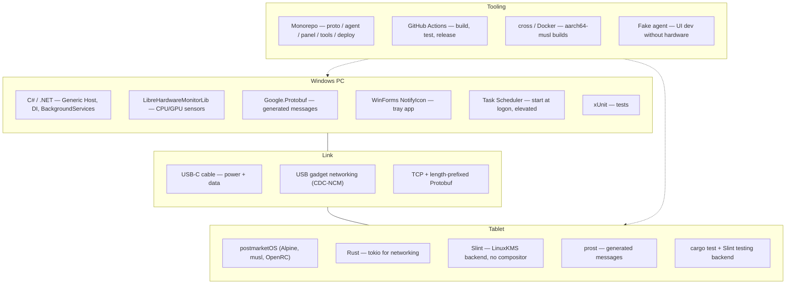

# Tech Stack — Sentinel

> Status: **Proposed**. Each choice lists its pros, cons, and the alternatives considered, so future-us knows *why*.

## Stack at a glance



## Toolchain versions

| Tool | Pinned version | Config file |
|---|---|---|
| .NET SDK | 9.0.306 | `global.json` (repo root) |
| Rust | 1.99.1 | `panel/rust-toolchain.toml` |
| Slint | 1.18.1 | `panel/Cargo.toml` |

To upgrade: update the version in the config file, run a local build to verify, then open a chore PR.

## Decisions

### 1. Hardware: ARM tablet running postmarketOS

Candidates: used Xiaomi Pad 5 (better screen, more setup) or PineTab2 (Linux out of the box, weaker specs). Final pick pending.

| Pros | Cons |
|---|---|
| ARM USB controllers support **gadget mode**, enabling single-cable power + data | Community-supported ports: some hardware may not work fully |
| postmarketOS supports USB networking out of the box | Xiaomi requires bootloader unlock and flashing |
| Real Linux: full control, great learning | Battery charge-limit support varies per device |
| Cheap used hardware fits the ~$200 budget | Fewer tutorials than mainstream distros |

**Alternatives considered:**
- *Surface Go (x86 + linux-surface)* — excellent Linux support, but its USB ports are host-only (no gadget mode) and it is picky about low-power USB-C charging.
- *Android tablet + kiosk app* — easiest and cheapest, but less control and less learning; not a Linux appliance.

### 2. Link: USB-C with USB gadget networking (CDC-NCM)

| Pros | Cons |
|---|---|
| One cable for power and data; no outlet needed | PC USB-C ports supply limited power (often 7.5–15 W) |
| No Wi-Fi or Bluetooth pairing; low latency, very reliable | Tablet battery stays plugged in permanently |
| Shows up on Windows as a normal network adapter | Depends on tablet kernel gadget support |
| Plain TCP sockets: transferable networking knowledge | |

**Alternatives considered:**
- *Wi-Fi/LAN* — works with any device, but needs a separate power source anyway.
- *Bluetooth (BLE)* — no cable for data, but flaky pairing/reconnects and awkward Windows APIs. Kept as a **stretch goal** (second transport).
- *USB HID (tablet as keyboard)* — can send hotkeys but cannot receive metrics.

### 3. Connection direction: tablet listens, agent dials out

| Pros | Cons |
|---|---|
| PC exposes no listening port (smaller attack surface) | Reconnect logic lives in the agent, which must handle the tablet rebooting |
| Tablet address on the USB link is fixed — no discovery needed | Slightly less conventional than "PC is the server" |

### 4. Protocol: length-prefixed Protobuf over TCP

| Pros | Cons |
|---|---|
| One schema, generated code for both languages | Binary format is harder to debug than JSON (mitigate with a debug dump tool) |
| Strongly typed, compact, handles binary payloads (cover art) | Must design framing ourselves |
| Built-in forward/backward compatibility rules | Code generation step in both builds |
| Good learning: framing, serialization, versioning | |

**Alternatives considered:** JSON over WebSocket (easier to debug, weaker typing, base64 for images); gRPC (heavier, HTTP/2 machinery is overkill on a point-to-point link).

### 5. PC agent: C# / .NET

| Pros | Cons |
|---|---|
| LibreHardwareMonitorLib is a native .NET library and handles the kernel driver needed for CPU temps on Windows | A second language in the project |
| First-class Windows APIs (Core Audio, media sessions, networking) for future features | Single-file self-contained exe is relatively large |
| Generic Host + DI make clean, testable services | |
| Mature tooling and testing (xUnit) | |

**Alternatives considered:** Rust everywhere (one language, but CPU temps on Windows require a kernel driver — painful without LHM); Python (fast to write, weaker for a long-running elevated tray app).

### 6. Agent hosting: tray app at logon (not a Windows Service)

| Pros | Cons |
|---|---|
| Runs in the user's session, so it **can** open Steam and other apps on the desktop | Only runs while a user is logged in (fine for this use case) |
| Visible status via tray icon | Elevated start needs a Task Scheduler entry |

### 7. Tablet app: Rust

| Pros | Cons |
|---|---|
| Single small native binary, no runtime | Steeper learning curve (ownership, async) |
| Memory safety for a long-running appliance | Cross-compiling to musl adds build setup |
| tokio is a mature async networking stack | |
| Strong learning value | |

### 8. UI toolkit: Slint (LinuxKMS backend)

| Pros | Cons |
|---|---|
| Renders straight to the display: no X11/Wayland, faster boot, true appliance feel | LinuxKMS backend is still marked **experimental** |
| Declarative `.slint` markup, good for polished UIs | Smaller ecosystem than Qt |
| Same app runs as a desktop window on Windows for fast UI iteration | Fewer ready-made chart widgets (we build sparklines ourselves) |

**Fallback:** Qt Quick (C++/QML) with `eglfs` — mature and also compositor-free. Flutter was considered but adds a Dart runtime.

### 9. Repo and CI: monorepo + GitHub Actions

| Pros | Cons |
|---|---|
| Protocol changes and both consumers change in one PR | CI must build two toolchains |
| Single place for docs, issues, releases | Larger repo |
| Actions can run tests, cross-compile aarch64-musl, and publish release artifacts | Self-hosted runner needed if we ever want automatic deploy to the tablet |

## Proposed repo layout

```
sentinel/
├── proto/            # sentinel.proto — single source of truth for the protocol
├── agent/            # Sentinel.Agent — C# solution (src/ + tests/)
├── panel/            # sentinel-panel — Rust crate + .slint UI files
├── tools/
│   └── fake-agent/   # streams fake metrics for UI development
├── deploy/           # OpenRC init script, Task Scheduler XML, flashing notes
├── docs/             # ARCHITECTURE.md, TECH_STACK.md, SPRINTS.md
└── .github/workflows/
```

## Risks to watch

| Risk | Impact | Mitigation |
|---|---|---|
| Slint KMS backend issues on the chosen tablet | UI won't render | Run Slint inside the `cage` kiosk compositor, or fall back to Qt |
| Tablet port lacks charge-limit support | Battery wear / swelling over time | Lower brightness; check device support before buying |
| Insufficient USB power from PC | Tablet slowly drains | Use the board's strongest USB-C header; dim the screen |
| LHM sensor names differ by hardware | Missing or mislabeled metrics | Map sensors by type, not name; hide missing tiles |
